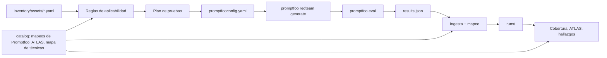

# Pertinax

**Saber cuáles de tus sistemas de IA se pueden romper y cuáles nadie ha intentado romper todavía.**

Pertinax mantiene un inventario de los activos de IA de una organización (chatbots, asistentes RAG, agentes, servidores MCP, copilotos), decide qué riesgos de OWASP y MITRE ATLAS aplican a cada uno, usa [Promptfoo](https://github.com/promptfoo/promptfoo) para atacarlos y guarda cada resultado mapeado a esos marcos.

Promptfoo es muy bueno haciendo red teaming contra *un* objetivo. Pertinax es la capa que lo rodea: qué IA tenemos, qué hay que probar en cada pieza y por qué, qué se ha probado de verdad, qué ha fallado y qué está pendiente de volver a probar.

*Pertinax* es "tenaz, obstinado" en latín: no suelta un objetivo hasta haberlo probado.

[English version](README.md)


## Qué hace

- **Inventario como código.** Un archivo YAML por activo de IA: qué es, quién es el responsable, qué datos toca, qué herramientas y autonomía tiene y cómo llega Promptfoo hasta él.
- **Aplicabilidad razonada.** Unas reglas legibles deciden qué riesgos del OWASP Top 10 para aplicaciones LLM (2025) y del OWASP Top 10 para aplicaciones agénticas aplican a cada activo, y dejan escrito el motivo. Cualquier decisión se puede sobrescribir (no aplica, aceptado, cubierto manualmente) con su justificación.
- **Planes de prueba para Promptfoo.** Para cada activo elige los plugins de Promptfoo que prueban los riesgos que aplican, descarta los que el activo no puede ejercitar (con el motivo) y genera un `promptfooconfig.yaml` estándar.
- **Ejecución e ingesta.** `pertinax run` llama a `promptfoo redteam generate` y `promptfoo eval` e incorpora los resultados. Los resultados de un CI o de otra máquina se importan con `pertinax ingest`.
- **Mapeo a los marcos.** Cada ataque que funciona se convierte en un hallazgo etiquetado con sus riesgos OWASP, tácticas ATLAS y técnicas ATLAS.
- **Panel.** Un muro de escudos de activos × riesgos, la cobertura por riesgo, el inventario proyectado sobre la matriz ATLAS, los hallazgos y un catálogo de qué prueba demuestra qué.
- **Control en CI.** `pertinax report --fail-on breach` hace fallar un pipeline si algún activo tiene un ataque que funciona.

## Cómo funciona



De dónde salen los mapeos:

| Mapeo | Fuente |
| --- | --- |
| Plugin de Promptfoo → OWASP LLM, OWASP Agentic, táctica ATLAS | Los mapeos de marcos del propio Promptfoo, extraídos del paquete instalado con `npm run sync:promptfoo` |
| Tácticas y técnicas de ATLAS | La publicación oficial de [mitre-atlas/atlas-data](https://github.com/mitre-atlas/atlas-data), compilada con `npm run sync:atlas` |
| Plugin o estrategia de Promptfoo → técnica ATLAS | `catalog/technique-map.yaml`, mantenido a mano en este repositorio y comprobado contra ATLAS en los tests |

Pertinax no se inventa qué prueba cubre qué riesgo: si Promptfoo cambia sus mapeos, vuelves a sincronizar y las dos herramientas vuelven a coincidir.

## Arranque rápido

Necesitas Node.js 22.22 o superior.

```bash
git clone https://github.com/0x0128/pertinax.git
cd pertinax
npm install
npm run dev
```

Abre http://localhost:3000. Hasta que lances tus propias pruebas, el panel enseña ejecuciones de ejemplo sintéticas de `examples/runs` y lo indica en cada página.

## Prueba real en tu máquina

El repositorio trae un chatbot vulnerable a propósito (`demo/vulnerable-bot`) y su ficha en el inventario (`inventory/assets/demo-bot.yaml`). Los ataques los escribe y los corrige un modelo local a través de [Ollama](https://ollama.com), así que nada sale de tu máquina.

```bash
ollama pull llama3.2
npm run demo:bot                     # terminal 1: el objetivo, en http://localhost:8787
npm run pertinax -- plan demo-bot    # terminal 2: qué se va a probar y por qué
npm run pertinax -- run demo-bot     # genera ataques, los lanza y guarda los resultados
npm run dev                          # mira los resultados
```

¿Sin Ollama? `npm run demo:bot -- --mock` responde con respuestas programadas igual de vulnerables. Promptfoo sigue necesitando un modelo para escribir y corregir los ataques: apunta `testing.attackProvider` y `testing.graderProvider` del activo a cualquier [proveedor de Promptfoo](https://www.promptfoo.dev/docs/providers/) al que tengas acceso. Con `remoteGeneration: true`, el servicio alojado de Promptfoo escribe los ataques y se habilitan más plugins.

Prueba solo sistemas que sean tuyos o para los que tengas autorización.

## Describir un activo

```yaml
# inventory/assets/support-assistant.yaml
id: support-assistant
name: Customer support assistant
kind: rag                      # chatbot | rag | agent | mcp-server | copilot | model-api
owner: customer-experience
exposure: public               # public | partner | internal
data:
  classification: confidential
  personalData: true
capabilities:
  rag: true
  rendersOutput: true
  tools:
    - name: get_order_status
      access: read             # read | write | execute
      source: internal         # internal | mcp | third-party
purpose: >
  Customer support assistant for an online shop. Must not reveal other customers' data.
target:                        # cualquier target de Promptfoo, se pasa tal cual
  id: http
  config:
    url: https://support.example.com/api/chat
    body: { message: '{{prompt}}' }
    transformResponse: json.answer
testing:
  depth: standard              # quick | standard | deep
  cadenceDays: 30
  indirectInjectionVar: article
risks:
  LLM03:
    status: covered-manually   # not-applicable | accepted | covered-manually
    reason: Vendor assessment completed, SDK versions pinned and scanned
    evidence: TPRM-2026-114
```

El esquema completo está en [`src/lib/schema.ts`](src/lib/schema.ts). `npm run validate` revisa todos los archivos.

Qué significa cada campo de `capabilities` para la aplicabilidad:

| Campo | Activa |
| --- | --- |
| `rag` | LLM04, LLM08, inyección indirecta y, en agentes, ASI06 |
| `tools` | LLM05, LLM06 y el bloque agéntico (ASI01, ASI02…) |
| `tools[].access: write/execute` | ASI03 y, con `execute`, ASI05 |
| `tools[].source: mcp/third-party` | ASI04 |
| `memory` | ASI06 y fugas entre sesiones |
| `multiAgent` | ASI03, ASI07, ASI08 |
| `autonomy: autonomous` | ASI08, ASI10 |
| `rendersOutput` / `codeExecution` | LLM05 |

## Línea de comandos

| Comando | Qué hace |
| --- | --- |
| `npm run pertinax -- list` | Activos con sus riesgos aplicables, brechas y última ejecución |
| `npm run pertinax -- plan <activo>` | Riesgos que aplican con su motivo, plugins elegidos y plugins descartados |
| `npm run pertinax -- generate <activo…> \| --all` | Escribe `generated/<activo>.promptfooconfig.yaml` |
| `npm run pertinax -- run <activo…> \| --all` | Genera ataques, los evalúa y los guarda en `runs/` |
| `npm run pertinax -- ingest results.json --asset <id>` | Importa un resultado de Promptfoo hecho en otro sitio |
| `npm run pertinax -- report [--json] [--fail-on breach\|untested\|stale]` | Resumen de cobertura para terminal o CI |
| `npm run validate` | Revisa el inventario y el catálogo |
| `npm run sync:promptfoo` / `npm run sync:atlas` | Actualiza los mapeos |

## Uso en CI

```yaml
- run: npm ci
- run: npm run pertinax -- run support-assistant
  env:
    OPENAI_API_KEY: ${{ secrets.OPENAI_API_KEY }}
- run: npm run pertinax -- report --fail-on breach
```

`.github/workflows/ci.yml` pasa la comprobación de tipos, los tests, la validación del inventario y la compilación en cada push.

## Estructura

```
catalog/            mapeos de Promptfoo, datos de ATLAS, mapa de técnicas
inventory/assets/   un YAML por activo de IA
runs/               tus ejecuciones (ignoradas por git: contienen ataques y respuestas)
examples/runs/      ejecuciones de ejemplo sintéticas para el primer arranque
src/lib/            esquema, aplicabilidad, planificación, generación, ingesta, cobertura
src/cli/            el comando pertinax
src/app/            el panel en Next.js
demo/               el bot vulnerable de demostración
scripts/            sincronización del catálogo y generación de ejemplos
tests/              tests unitarios y un resultado real de Promptfoo como fixture
```

## Límites

- Las reglas de aplicabilidad son un punto de partida. Reflejan lo que dice el inventario: un inventario incompleto da una cobertura incompleta.
- Algunos riesgos (por ejemplo LLM03 Supply Chain) no tienen prueba automática en Promptfoo. Pertinax los marca como revisión manual hasta que registres evidencias o una decisión.
- El mapa a nivel de técnica ATLAS está hecho a mano y cubre las técnicas que Promptfoo prueba con claridad; el resto se mapea solo a nivel de táctica.
- Un hallazgo se cierra cuando una ejecución posterior prueba el mismo plugin y no pasa ningún ataque. Todavía no hay flujo de tickets.

## Hoja de ruta

- Lanzar pruebas desde el panel y ver el progreso
- Ciclo de vida de hallazgos con responsable y fecha
- Importar el inventario desde servicios de IA en la nube y gateways
- Exportar la cobertura como capa de ATLAS Navigator

## Licencia y atribución

MIT, ver [LICENSE](LICENSE). Pertinax no está afiliado a Promptfoo, OWASP ni MITRE. Los datos de MITRE ATLAS son © MITRE y se usan bajo la licencia Apache 2.0; los nombres de los riesgos OWASP proceden del OWASP GenAI Security Project. Ver [NOTICE](NOTICE).
