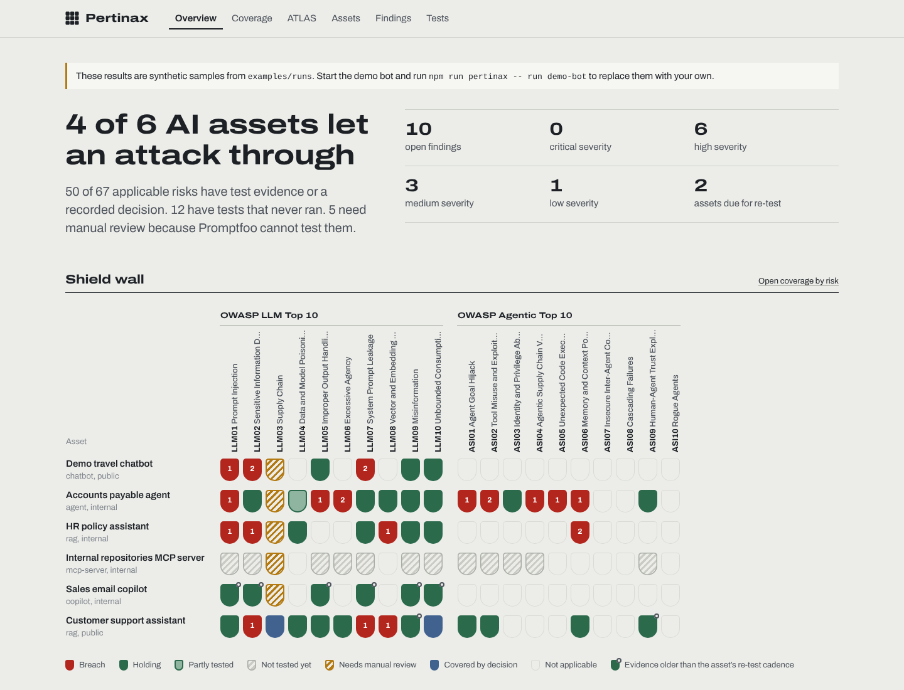
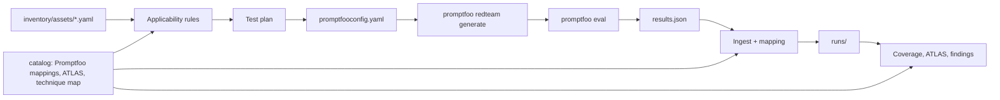

# Pertinax

**Know which of your AI systems can be broken, and which ones nobody has tried to break yet.**

Pertinax keeps an inventory of an organisation's AI assets (chatbots, RAG assistants, agents, MCP servers, copilots), works out which OWASP and MITRE ATLAS risks apply to each one, drives [Promptfoo](https://github.com/promptfoo/promptfoo) to attack them, and keeps every result mapped back to those frameworks.

Promptfoo is excellent at red-teaming *one* target. Pertinax is the layer around it: what AI do we have, what should be tested on each piece and why, what has actually been tested, what broke, and what is overdue.

*Pertinax* is Latin for stubborn, tenacious: it does not let go of a target until it has been tested.

[Versión en español](README.es.md)



## What it does

- **Inventory as code.** One YAML file per AI asset: what it is, who owns it, what data it touches, what tools and autonomy it has, and how Promptfoo should reach it.
- **Applicability with reasons.** Readable rules decide which risks of the OWASP Top 10 for LLM Applications (2025) and the OWASP Top 10 for Agentic Applications apply to each asset, and record why. You can override any decision (not applicable, accepted, covered manually) with a justification.
- **Test plans for Promptfoo.** For each asset Pertinax picks the Promptfoo plugins that test the applicable risks, leaves out the ones the asset cannot exercise (with the reason), and writes a standard `promptfooconfig.yaml`.
- **Runs and ingestion.** `pertinax run` calls `promptfoo redteam generate` and `promptfoo eval`, then ingests the results. Results from CI or another machine can be imported with `pertinax ingest`.
- **Mapping to the frameworks.** Every failed attack becomes a finding tagged with OWASP risks, ATLAS tactics and ATLAS techniques.
- **Dashboard.** A shield wall of assets × risks, coverage by risk, your inventory projected on the ATLAS matrix, findings, and a catalogue of which test proves what.
- **CI gate.** `pertinax report --fail-on breach` fails a pipeline when any asset has a working attack.

## How it works



Where the mappings come from:

| Mapping | Source |
| --- | --- |
| Promptfoo plugin → OWASP LLM, OWASP Agentic, ATLAS tactic | Promptfoo's own framework mappings, extracted from the installed package by `npm run sync:promptfoo` |
| ATLAS tactics and techniques | The official [mitre-atlas/atlas-data](https://github.com/mitre-atlas/atlas-data) release, compiled by `npm run sync:atlas` |
| Promptfoo plugin or strategy → ATLAS technique | `catalog/technique-map.yaml`, curated in this repository and checked against ATLAS by the tests |

Pertinax never invents which test covers which risk: if Promptfoo changes its mappings, re-run the sync and both tools agree again.

## Quick start

Requires Node.js 22.22 or later.

```bash
git clone https://github.com/0x0128/pertinax.git
cd pertinax
npm install
npm run dev
```

Open http://localhost:3000. Until you run your own tests, the dashboard shows synthetic sample runs from `examples/runs` and says so on every page.

## Try a real run on your machine

The repository includes a deliberately vulnerable chatbot (`demo/vulnerable-bot`) and an inventory entry for it (`inventory/assets/demo-bot.yaml`). Attacks are written and graded by a local model through [Ollama](https://ollama.com), so nothing leaves your machine.

```bash
ollama pull llama3.2
npm run demo:bot                     # terminal 1: the target, on http://localhost:8787
npm run pertinax -- plan demo-bot    # terminal 2: what will be tested and why
npm run pertinax -- run demo-bot     # generate attacks, run them, record the results
npm run dev                          # look at the results
```

No Ollama? `npm run demo:bot -- --mock` answers with scripted, equally vulnerable replies. Promptfoo still needs a model to write and grade the attacks: point `testing.attackProvider` and `testing.graderProvider` in the asset file at any [Promptfoo provider](https://www.promptfoo.dev/docs/providers/) you have access to. With `remoteGeneration: true`, Promptfoo's hosted service writes the attacks instead and more plugins become available.

Only test systems you own or are authorised to test.

## Describe an asset

```yaml
# inventory/assets/support-assistant.yaml
id: support-assistant
name: Customer support assistant
kind: rag                      # chatbot | rag | agent | mcp-server | copilot | model-api
owner: customer-experience
exposure: public               # public | partner | internal
data:
  classification: confidential
  personalData: true
capabilities:
  rag: true
  rendersOutput: true
  tools:
    - name: get_order_status
      access: read             # read | write | execute
      source: internal         # internal | mcp | third-party
purpose: >
  Customer support assistant for an online shop. Must not reveal other customers' data.
target:                        # any Promptfoo target, passed through unchanged
  id: http
  config:
    url: https://support.example.com/api/chat
    body: { message: '{{prompt}}' }
    transformResponse: json.answer
testing:
  depth: standard              # quick | standard | deep
  cadenceDays: 30
  indirectInjectionVar: article
risks:
  LLM03:
    status: covered-manually   # not-applicable | accepted | covered-manually
    reason: Vendor assessment completed, SDK versions pinned and scanned
    evidence: TPRM-2026-114
```

The full schema is in [`src/lib/schema.ts`](src/lib/schema.ts). `npm run validate` checks every file.

## Command line

| Command | What it does |
| --- | --- |
| `npm run pertinax -- list` | Assets with their applicable risks, breaches and last run |
| `npm run pertinax -- plan <asset>` | Applicable risks with reasons, plugins chosen and plugins left out |
| `npm run pertinax -- generate <asset…> \| --all` | Write `generated/<asset>.promptfooconfig.yaml` |
| `npm run pertinax -- run <asset…> \| --all` | Generate attacks, evaluate, ingest into `runs/` |
| `npm run pertinax -- ingest results.json --asset <id>` | Import a Promptfoo results file made elsewhere |
| `npm run pertinax -- report [--json] [--fail-on breach\|untested\|stale]` | Coverage summary for the terminal or CI |
| `npm run validate` | Check the inventory and the catalog |
| `npm run sync:promptfoo` / `npm run sync:atlas` | Refresh the mappings |

## Use it in CI

```yaml
- run: npm ci
- run: npm run pertinax -- run support-assistant
  env:
    OPENAI_API_KEY: ${{ secrets.OPENAI_API_KEY }}
- run: npm run pertinax -- report --fail-on breach
```

`.github/workflows/ci.yml` runs type checks, tests, inventory validation and the build on every push.

## Project layout

```
catalog/            Promptfoo mappings, ATLAS data, technique map
inventory/assets/   one YAML file per AI asset
runs/               your runs (git-ignored: they contain attacks and model output)
examples/runs/      synthetic sample runs for the first launch
src/lib/            schema, applicability, planning, generation, ingestion, coverage
src/cli/            the pertinax command
src/app/            the Next.js dashboard
demo/               the vulnerable demo bot
scripts/            catalog sync and sample generation
tests/              unit tests and a real Promptfoo output fixture
```

## Limits

- Applicability rules are a starting point. They reflect what the inventory says, so an incomplete inventory gives incomplete coverage.
- Some risks (for example LLM03 Supply Chain) have no automated Promptfoo test. Pertinax shows them as needing manual review until you record evidence or a decision.
- The technique-level ATLAS map is curated by hand and covers the techniques Promptfoo tests clearly; everything else is mapped at tactic level only.
- A finding closes when a later run tests the same plugin and nothing gets through. There is no ticketing workflow yet.

## Roadmap

- Run tests from the dashboard and stream progress
- Findings lifecycle with owners and due dates
- Import the inventory from cloud AI services and gateways
- Export coverage as an ATLAS Navigator layer

## License and attribution

MIT, see [LICENSE](LICENSE). Pertinax is not affiliated with Promptfoo, OWASP or MITRE. MITRE ATLAS data is © MITRE and used under the Apache License 2.0; OWASP risk names are from the OWASP GenAI Security Project. See [NOTICE](NOTICE).
